# Lotería Push — Notificaciones push (FCM) con un cantor de Lotería en la nube

## Ciclo TDD — Evidencias

🔴 **ROJO:** se escribe la prueba primero; falla porque el código todavía no existe.
🟢 **VERDE:** se escribe el código mínimo para que la prueba pase.
🔵 **REFACTOR:** se ordena el código sin romper las pruebas.

### 1. Servidor en Node
**🔴 Rojo**

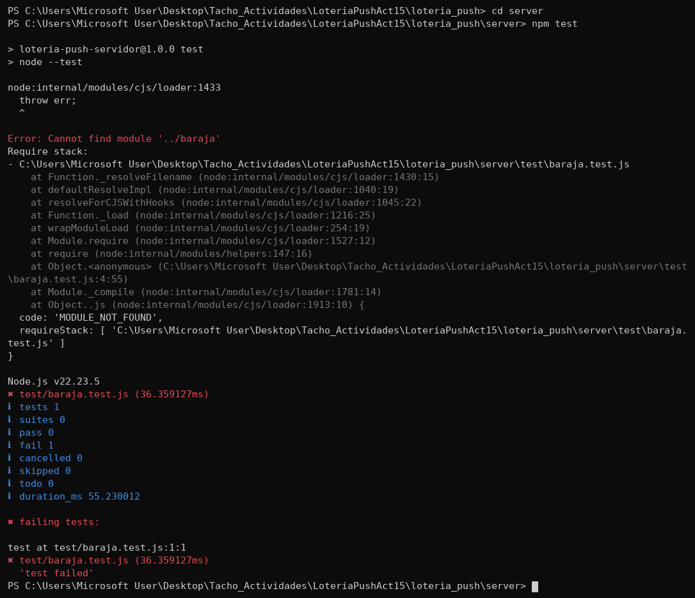

**🟢 Verde**

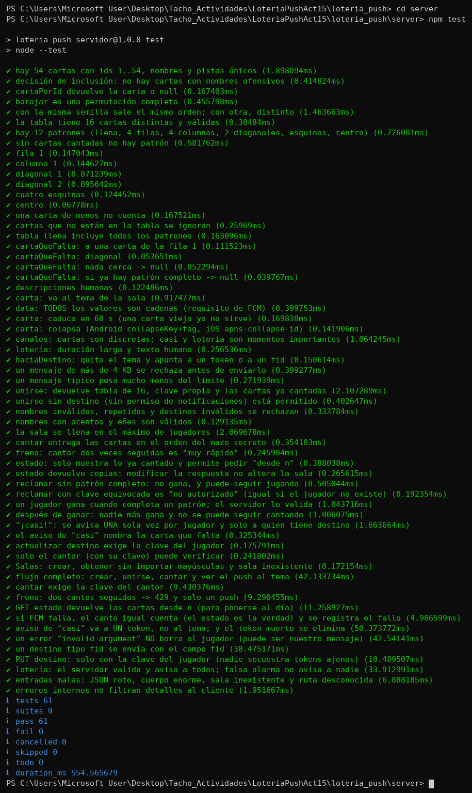

### 2. Eventos y líneas (app)
**🔴 Rojo**

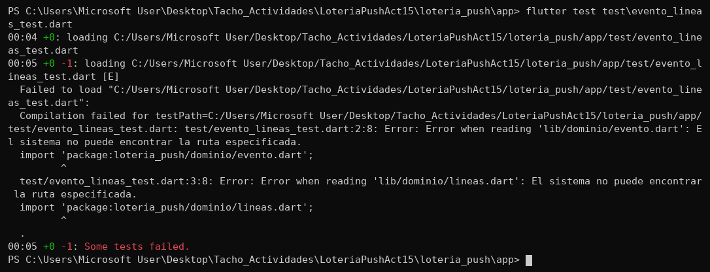

**🟢 Verde**

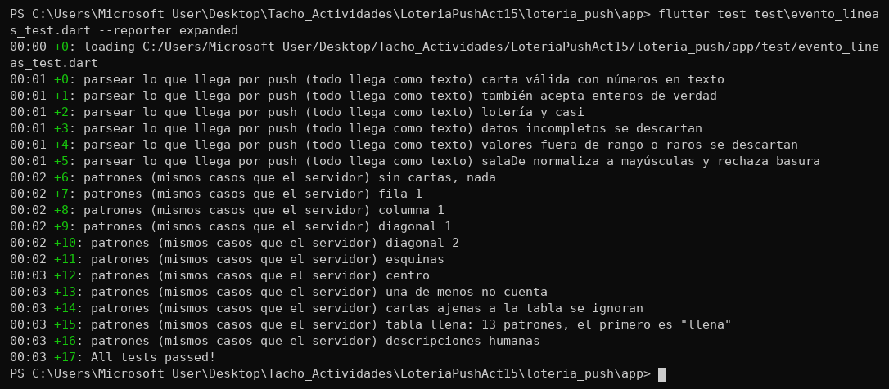

### 3. Partida
**🔴 Rojo**

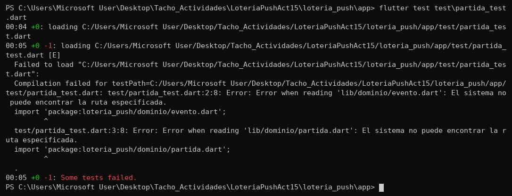

**🟢 Verde**

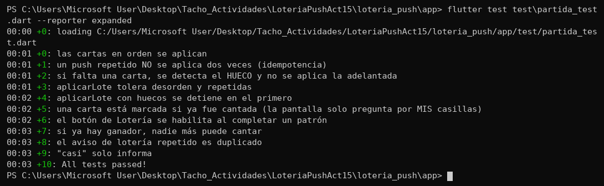

### 4. Controlador
**🔴 Rojo**

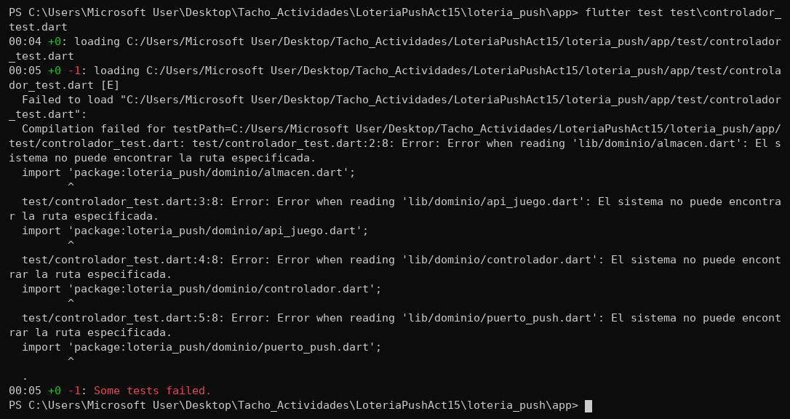

**🟢 Verde**

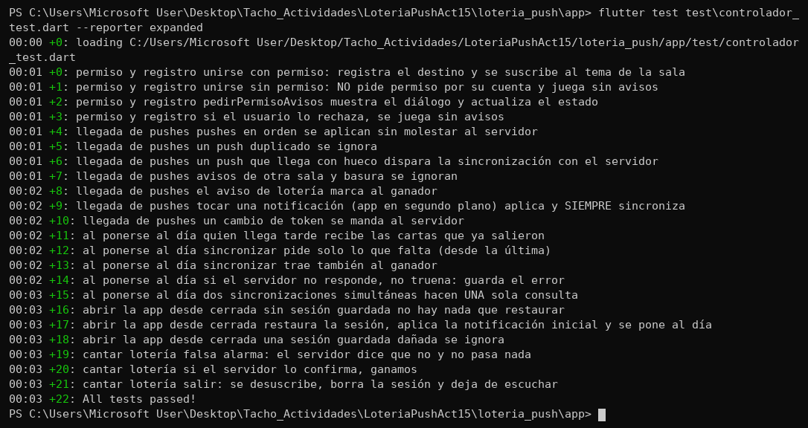

### 5. Pantalla (pruebas de widgets)
**🔴 Rojo**

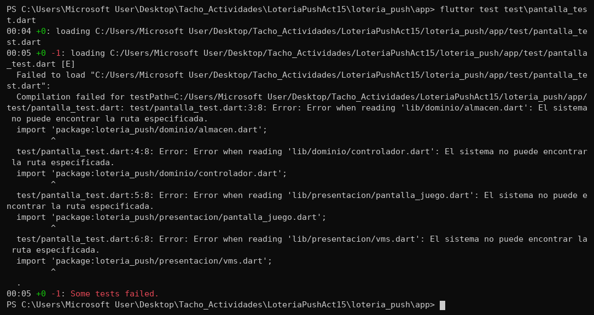

**🟢 Verde**

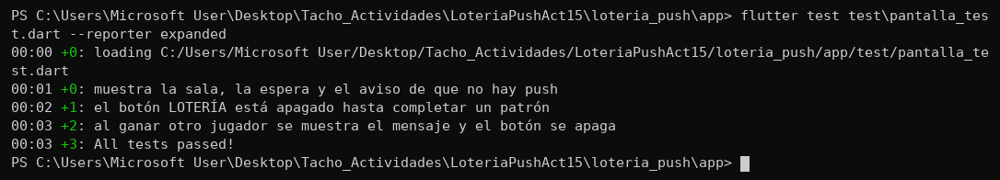

### 6. Todas las pruebas de Flutter
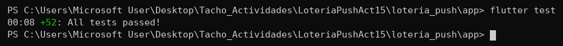

---